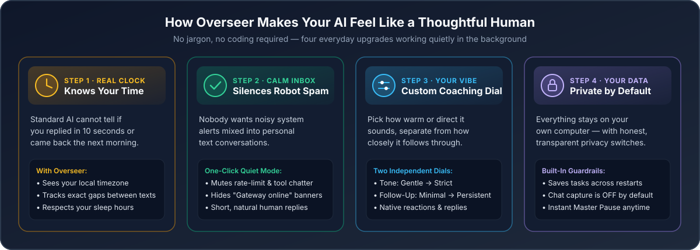
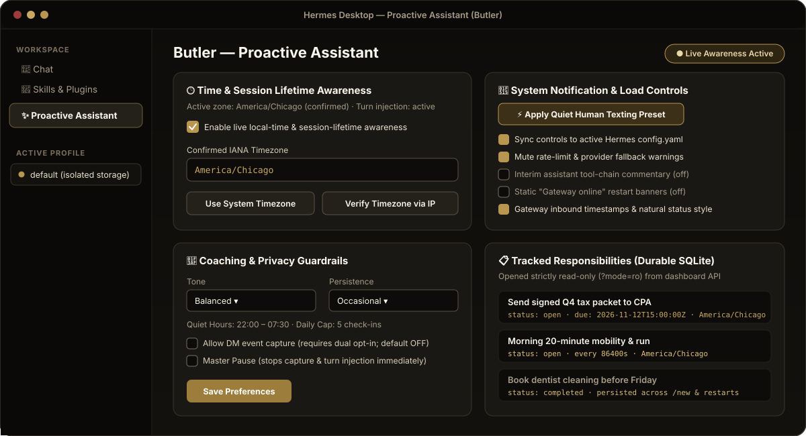
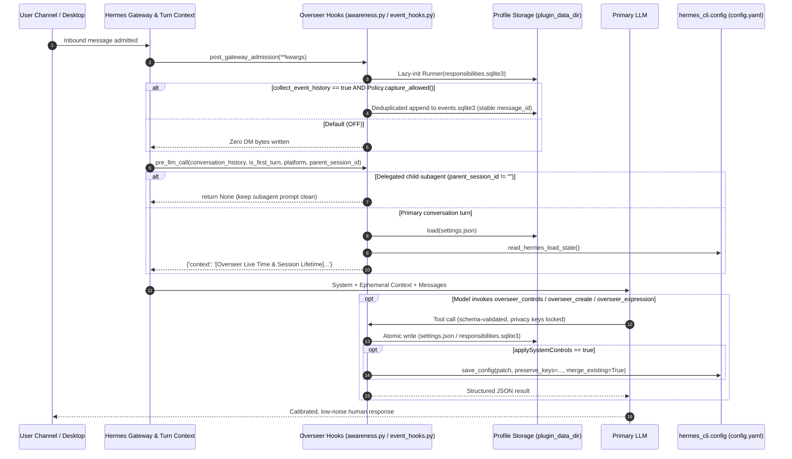
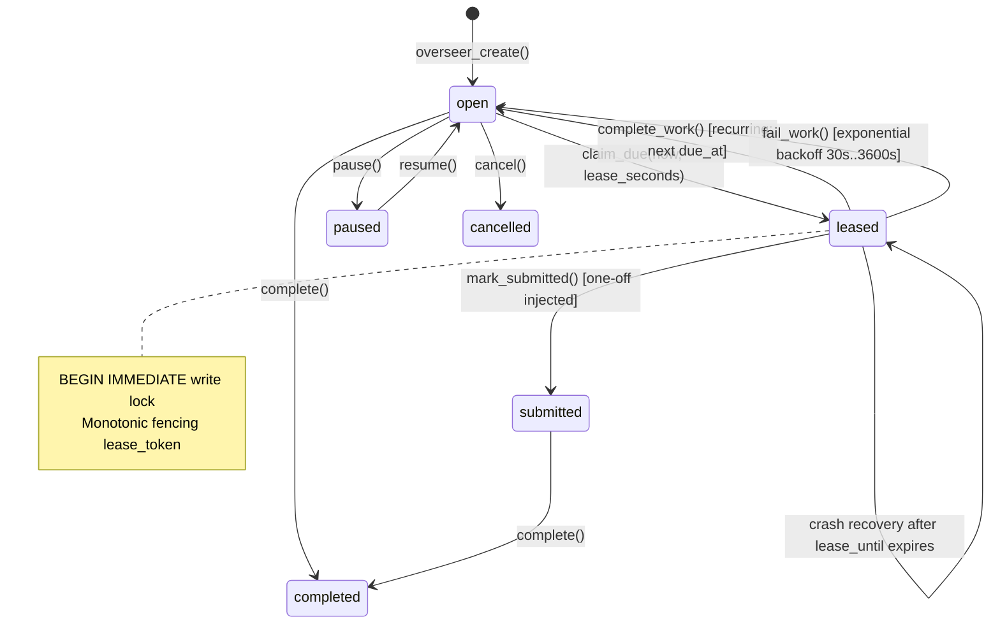

<div align="center">

# Overseer for Hermes Agent

**Turn your personal AI from a stateless chatbot into a calm, time-aware, human-feeling assistant — with privacy-first guardrails you control.**

[](plugin.yaml)
[](plugin.yaml)
[](tests/)
[-a78bfa?style=for-the-badge)](#7-defense-in-depth-privacy-consent--fail-closed-security)
[](LICENSE)

<br/>


</div>

---

## How This Guide Is Organized

This repository is intentionally written in **two halves** so anyone can read as far as they need:

| Section | Who It's For | What You'll Learn |
| :--- | :--- | :--- |
| **[Part I — Everyday Guide](#part-i--everyday-guide-no-technical-background-needed)** | **Everyone** (zero coding or AI jargon) | Why AI assistants often feel robotic, what Overseer changes in plain English, visual walkthroughs, before-and-after examples, and 60-second setup. |
| **[Part II — Technical & Engineering Reference](#part-ii--technical-architecture--engineering-reference)** | **Developers, security reviewers & plugin authors** | Public Hermes SDK architecture, `pre_llm_call` & `post_gateway_admission` lifecycles, SQLite `BEGIN IMMEDIATE` leasing, dual-gate consent, fail-closed session boundaries, `config.yaml` sync matrix, REST/tool schemas, and benchmarks. |

---

# Part I — Everyday Guide (No Technical Background Needed)

## 1. Why Most AI Assistants Still Feel Like Robots

Even the smartest AI models today have a surprisingly human blind spot: **they live inside a room with no clock and no memory of how noisy they are being.**

When you use an AI assistant over text messages (like iMessage or Telegram) or on your computer, three frustrating things happen almost right away:

1. **Time freezes between messages.** Standard AI cannot tell whether you replied **8 seconds later** or walked away, slept through the night, and texted back **14 hours later** the next morning. So it either apologizes for imaginary delays, rushes you when you're busy, or ignores the fact that it's 11:30 PM.
2. **Robot system chatter floods your personal inbox.** Instead of feeling like texting a thoughtful assistant, your chat fills up with automated machine alerts: *"Gateway online"*, *"Primary provider rate-limited — switching to backup"*, *"Running tool 3 of 7..."*, or *"Tip: save this as a skill!"*
3. **Promises vanish when you start a fresh chat.** If you ask your assistant to help you stay on top of a tax deadline, a workout habit, or a dentist appointment, starting a new conversation often wipes the slate clean — or worse, gives you no simple dial to say *"be gentle with me"* versus *"hold me strictly accountable."*

**Overseer fixes all three** as a clean add-on for **Hermes Agent** and **Hermes Desktop** — while keeping all of your data on your own computer.

---

## 2. Four Everyday Ways Overseer Upgrades Your Assistant

<p align="center">
  
</p>

### 1) It Actually Knows Your Time — and How Long You Were Gone

Overseer gives your assistant a real wristwatch set to **your local timezone** (whether you're in Chicago, New York, London, or traveling). Before every reply, your assistant quietly sees:

- What day and time it is for you right now (early morning, workday afternoon, or late night).
- How long this conversation has been going on.
- **Exactly how much time passed** since your last message and since its own last reply.
- Whether you are currently in your **Quiet Hours** (for example, 10:00 PM to 7:30 AM).

During setup, Overseer can automatically detect your computer's timezone — and if you want to double-check while traveling, you can verify it from your internet connection with a single click.

---

### 2) One-Click "Quiet Human Mode" Silences Robot Spam

<p align="center">
  
</p>

When your main AI provider runs out of usage for the hour and Hermes smoothly switches to your backup model, you shouldn't get nagged about it on every single text message. With Overseer's **Quiet Human Texting Preset**, one click turns off the clutter:

- **Silences provider fallback & rate-limit nagging** when your backup model is already handling things.
- **Hides step-by-step tool chatter** (*"Reading file... searching web..."*) so you just get the helpful answer.
- **Stops repetitive *"Gateway online"* restart banners** from buzzing your phone every time your computer reboots.
- **Turns off unsolicited *"create a skill"* and memory pop-ups** while keeping genuine safety warnings active.

Prefer seeing some of those updates? Every single category has its own toggle so you can customize exactly what gets through.

---

### 3) Two Separate Dials: *How It Speaks* vs. *How Often It Follows Up*

<p align="center">
  
</p>

Most reminder apps confuse **rudeness** with **helpfulness**. Overseer separates your assistant's personality into two independent sliders:

- **Tone (How It Sounds):** Choose **Gentle**, **Balanced**, **Direct**, **Firm**, or **Strict**. You can have a warm, encouraging assistant that is still rock-solid at tracking your goals — or a no-nonsense coach that gets straight to the point.
- **Persistence (How Closely It Checks In):** Choose **Minimal**, **Occasional**, **Steady**, **Proactive**, or **Persistent**, paired with a **Daily Check-In Limit** so it never overwhelms your day.
- **Natural Messaging Expressions:** On supported channels like iMessage (via Photon), your assistant can react with a quick tapback (👍, ❤️, !!), reply directly to a specific thread bubble, or celebrate a finished milestone without sending an unnecessary wall of text.

---

### 4) One Clean Control Center — Private & Safe by Default

<p align="center">
  
</p>

Overseer adds a dedicated **Proactive Assistant** tab right inside the Hermes Desktop sidebar (and keeps working in the background even when the Desktop window is closed):

- **Your tasks survive fresh chats and restarts:** Commitments saved with Overseer live in their own durable local file on your computer, so starting a `/new` chat never erases what matters.
- **Private by default:** Overseer **does not** record your private chat messages unless you deliberately unlock **two separate switches** yourself.
- **Never asks for passwords in chat:** If something ever needs a login or verification code, your assistant guides you through Hermes's secure connection screen rather than asking you to paste secrets into a message.
- **Instant Master Pause:** Going on vacation or into a deep-focus afternoon? One click on **Master Pause** pauses Overseer immediately.

---

## 3. Everyday Moments: Without Overseer vs. With Overseer

| Everyday Situation | Without Overseer | With Overseer |
| :--- | :--- | :--- |
| **You reply the next morning after 11 hours** | Picks up mid-sentence as if 2 seconds passed, or invents a random guess about time. | Sees *"8:14 AM CST · 11h 12m since previous message"* and greets your morning naturally. |
| **Your main AI model hits a temporary rate limit** | Sends annoying warning banners alongside normal backup replies—and doesn't even know you're seeing them. | **Quiet Human Mode** mutes repetitive provider/credit warnings automatically, or lets you tell your assistant *"quiet those alerts"* right in chat. |
| **Your home server restarts at 2:00 AM** | Pings your phone with a robotic *"♻️ Gateway online"* message. | Suppresses static restart banners and respects your **Quiet Hours** window. |
| **You say *"Make sure I send the tax packet Friday"*** | Buried in scrollback; forgotten as soon as you type `/new`. | Saved durably in your local Overseer responsibility list across sessions and restarts. |
| **You just say *"Got it, thanks!"* on iMessage** | Replies with a 3-sentence paragraph saying *"You're very welcome! Let me know if..."* | Sends a clean 👍 tapback reaction or a crisp human one-liner. |

---

## 4. Quick Setup (Under 60 Seconds)

1. **Place or install Overseer** into your Hermes plugins folder (`~/.hermes/plugins/overseer`).
2. **Open Hermes Desktop** and click **Proactive Assistant** in the left sidebar — *or* simply text your Hermes assistant:
   > *"Check my Overseer timezone and turn on the Quiet Human preset."*
3. **Confirm your timezone & coaching style**, click **Save Preferences**, and enjoy a calmer, time-aware assistant.

<br/>

---

# Part II — Technical Architecture & Engineering Reference

> **Audience shift:** Everything below is written for engineers, security auditors, and Hermes plugin authors inspecting how Overseer works under the hood.

## 5. Architectural Overview & Core Invariants

Overseer (`v0.2.0`, `requires_hermes: ">=0.23.1"`) is a unified **Hermes Agent + Hermes Desktop** standalone plugin built strictly against **public Hermes SDK surfaces** (`hermes_cli/data/plugin_api.json`).

<p align="center">
  
</p>

### Engineering Design Principles

1. **Zero Private Core Imports & Zero Monkey-Patching:** Validated with `hermes plugins validate . --json` (**16/16 checks passing, 0 warnings**). Overseer imports only sanctioned public interfaces (`plugins.plugin_storage.plugin_data_dir` and `hermes_cli.config.{load_config, save_config}`), never touches internal gateway routers or private session globals, and never mutates core methods at runtime.
2. **Model-First Reasoning Over Brittle Heuristics:** Rather than hardcoding regex rules or chaining secondary "judge" prompts that leak deliberation tokens, Overseer injects deterministic temporal/posture telemetry via `pre_llm_call` and exposes capability-gated tools (`overseer_controls`, `overseer_create`, `overseer_manage`, `overseer_expression`) so the primary model decides when and how to act.
3. **Fail-Closed Security When Public Identity Is Absent:** Wherever the current public Hermes SDK lacks an unspoofable cryptographic/contextvar binding between gateway admission and downstream tool/hook calls, Overseer **fails closed** rather than falling back to spoofable environment variables (`HERMES_SESSION_KEY`) or timing heuristics.
4. **Dynamic Per-Profile Storage Isolation:** Every SQLite database and settings file resolves dynamically inside `plugin_data_dir('overseer')` at call time (`~/.hermes/profiles/<profile>/plugin-data/overseer/`), ensuring multi-profile setups never cross-contaminate state.

---

## 6. Per-Turn Execution & Hook Lifecycle

<p align="center">
  
</p>

### Step-by-Step Runtime Sequence



### How Session Lifetime & Timezone Resolution Work (`overseer/context.py`)

- **Deterministic Timezone Precedence (`resolve_effective_timezone`):**
  1. `profile`: Explicit IANA zone validated via `zoneinfo.ZoneInfo` in Overseer `settings.json` (rejects leading `/`, `..`, >128 chars, or unknown zones).
  2. `hermes_config`: Active Hermes `config.yaml` `timezone` key.
  3. `system_detected`: Local host inspection (`$TZ` → `/etc/localtime` symlink target under `/zoneinfo/` → `/etc/timezone`) with **zero network calls**.
  4. `utc_fallback`: Safe fallback to `UTC` with an explicit onboarding hint so the assistant knows the user's zone is unconfirmed.
- **Opt-In IP Verification (`detect_ip_timezone`):** Never runs automatically in background turns. Invoked **only** when the user clicks **Verify Timezone via IP** in Hermes Desktop or asks the agent to run `overseer_controls(action="detect_timezone", use_ip=True)` (`https://ipapi.co/timezone` with fallback to `https://worldtimeapi.org/api/ip`, 3s timeout, strict `ZoneInfo` validation on response).
- **Content-Blind Turn-Gap Calculation (`summarize_session_lifetime`):** Inspects **only** `role` (`user` / `assistant`) and numeric/ISO `timestamp` metadata on the in-memory `conversation_history` list—never reading or copying message prose. Excludes the trailing staged user message when computing `since_previous_user_seconds` so the model receives exact elapsed durations (`session_age_human`, `since_previous_user_human`, `since_last_assistant_human`) alongside turn index and active quiet-hours state.

Example ephemeral block returned by `AwarenessHooks.pre_llm_call`:

```text
[Overseer Live Time & Session Lifetime on photon]
Local time: Wednesday, 2026-11-11 08:15:00 CST (UTC-06:00, America/Chicago — confirmed in Overseer profile; morning).
Session lifetime: turn 4; session age 11h 20m; elapsed since user's previous message 9h 42m; elapsed since your last reply 9h 41m. Use exact elapsed gaps to calibrate pacing—never guess wait durations, acknowledge long/overnight gaps naturally, and stay crisp on rapid exchanges.
Posture: tone=Balanced, persistence=Occasional, quiet_hours=inactive (window 22:00–07:30).
Communication & status load: write like a concise, attentive human—short natural messages, no robotic status banners or repetitive boilerplate.
System notification/load controls (synced to Hermes config): warnings_muted=True, tool_progress=off, interim_narration=False, skill_nudges=False, gateway_restart_banner=False. If the user asks to quiet or change system/provider/tool/session notifications or confirm their timezone, use overseer_controls.
```

---

## 7. Defense-in-Depth: Privacy, Consent & Fail-Closed Security

<p align="center">
  
</p>

### 7.1 Dual-Lock Opt-In DM Event Capture (`overseer/event_hooks.py` & `overseer/events.py`)

Admitted inbound DM observation is **disabled by default** (`0` database files created unless opted in) and requires **two independent locks** to be enabled simultaneously:

1. **Host Config Lock:** `plugins.entries.overseer.settings.collect_event_history: true` in Hermes `config.yaml` (schema default: `false`).
2. **Profile Consent Lock:** `Policy(profile_dir).capture_allowed()` requires `activityEnabled: true` **and** `paused: false` in the active profile's `settings.json`.

Additional safeguards when both locks are enabled:
- **LLM Privilege Separation (`_MODEL_MUTABLE_KEYS`):** `overseer_controls` explicitly strips `activityEnabled` and `notificationsEnabled` from model-writable keys (`awareness.py:19-21`). A prompt injection or confused model turn **cannot** turn on DM capture; only the user via the authenticated Desktop Preferences UI can toggle it.
- **Deduplication & Bounded Window:** Messages lacking a stable platform `message_id` are ignored (`event_hooks.py:55-58`). Ledger storage enforces capacity bounds, checkpoint conflicts (`CheckpointConflict`), and 7-day / newest-10 selection windows with explicit overflow counts and zero silent character clipping.
- **Untrusted Data Fencing:** Stored events are wrapped in `<untrusted_event_content>` XML boundaries with control characters escaped so observed text is never mistaken for system instructions.

### 7.2 Why Scheduled Wake Routing & DM Replay Currently Fail Closed (`upstream 79fb37f8`)

During security auditing against Hermes `>=0.23.1` (`79fb37f8`), we verified an important SDK boundary:
- `post_gateway_admission` receives an authoritative inbound session key at admission time.
- However, inside tool calls (`overseer_create`) and `pre_llm_call`, the public helper `hermes_cli.plugin_session.session_key()` falls back to `os.environ["HERMES_SESSION_KEY"]` when unbound—which a subprocess or caller environment could spoof—while the true bound ContextVar (`gateway.session_context`) is a **private internal module** disallowed by catalog rule 9.

Rather than violating catalog isolation or trusting spoofable environment variables:
- `overseer/tools.py` stores responsibilities durably in SQLite (`scheduled: false`) without binding unverified session keys.
- `overseer/runner.py` refuses legacy/unauthenticated `session_key` metadata.
- `overseer/event_hooks.py` keeps cross-turn DM ledger replay disabled until Hermes exposes an authenticated public turn-origin session identity API.

### 7.3 Durable SQLite State Machine & Fencing Leases (`overseer/store.py` & `overseer/policy.py`)



- **Crash-Safe Fenced Claims:** `ResponsibilityStore.claim_due()` executes inside `BEGIN IMMEDIATE`, assigning a unique `lease_token` and `lease_until` deadline. Subsequent `complete_work`, `mark_submitted`, or `fail_work` mutations verify both `id` and `lease_token`, preventing split-brain double execution across restarts.
- **Injection != Delivery:** One-off responsibilities transition to `submitted` (accepted by host injection), never falsely claiming confirmed end-user read receipts.
- **Atomic Cross-Process Wake Reservations:** `Policy.reserve_wake(now)` validates `notificationsEnabled`, `!paused`, and IANA local quiet hours (handling both same-day `09:00–17:00` and overnight `22:00–07:30` spans), then atomically increments `(local_day, count)` inside `policy.sqlite3` under `BEGIN IMMEDIATE` to enforce `dailyLimit`.

---

## 8. System Notification & Load Control Sync Matrix

When `applySystemControls: true` (enabled automatically by the `quiet_human` preset or toggled in Desktop UI / `overseer_controls`), `overseer/notifications.py` calls `hermes_cli.config.save_config(patch, preserve_keys=preserve, merge_existing=True)` so explicit `false`/`0` overrides survive default-stripping and stay synchronized across per-platform display blocks:

| Overseer Setting | Default | `quiet_human` Preset | Synced Hermes `config.yaml` Key Path(s) | Runtime Effect |
| :--- | :---: | :---: | :--- | :--- |
| `suppressWarningNotifications` | `true` | `true` | `display.suppress_warning_notifications`<br/>`display.credits_notices` (inverted)<br/>`display.platforms.<plat>.suppress_warning_notifications` | Silences repetitive provider fallback, rate-limit, and out-of-credits warning banners in user chats. |
| `toolProgressMode` | `'off'` | `'off'` | `display.tool_progress`<br/>`display.platforms.<plat>.tool_progress` | Controls mid-turn tool progress spam (`off`, `new`, `all`, `verbose`). |
| `interimAssistantMessages` | `false` | `false` | `display.interim_assistant_messages`<br/>`display.show_commentary`<br/>`display.platforms.<plat>.interim_assistant_messages` | Suppresses chatty mid-tool narration bubbles before the final answer is ready. |
| `busyAckNotifications` | `false` | `false` | `display.busy_ack_enabled`<br/>`display.busy_ack_detail`<br/>`display.busy_steer_ack_enabled`<br/>`display.platforms.<plat>.busy_ack_detail` | Suppresses robotic *"working on another turn / queued"* ack banners. |
| `longRunningNotifications` | `false` | `false` | `display.long_running_notifications`<br/>`agent.gateway_notify_interval` (`0` vs `180`)<br/>`display.platforms.<plat>.long_running_notifications` | Controls periodic *"still running..."* status pings during long tasks. |
| `backgroundProcessNotifications` | `'error'` | `'error'` | `display.background_process_notifications` | Limits background job alerts (`off`, `error`, `concise`, `result`, `all`). |
| `memoryNotifications` | `'off'` | `'off'` | `display.memory_notifications`<br/>`display.platforms.<plat>.memory_notifications` | Hides routine memory-save status notices (`off` vs `on`). |
| `skillNudgesEnabled` | `false` | `false` | `skills.creation_nudge_interval` (`0` vs `15`) | Disables periodic self-improvement / *"create a skill"* nudges when `false`. |
| `gatewayRestartNotifications` | `false` | `false` | `platforms.<plat>.gateway_restart_notification` | Suppresses static `♻️ Gateway online` startup/restart pings across configured platforms.* |
| `gatewayMessageTimestamps` | `true` | `true` | `gateway.message_timestamps.enabled` | Enables native gateway inbound message timestamp decoration for temporal accuracy. |
| `naturalStatusStyle` | `true` | `true` | `display.ephemeral_system_ttl` (`15` vs `0`) + `pre_llm_call` guidance | Auto-expires transient TUI/Desktop system notices (15s) and instructs concise human phrasing. |
| `timezone` | `''` | Detected IANA | `timezone` (when non-empty) | Syncs confirmed IANA timezone to root Hermes config. |

> \* **Architectural transparency note:** Hermes core does not currently expose a public template hook to rewrite the static `Gateway online` banner string; setting `gatewayRestartNotifications: false` suppresses the static banner cleanly via public config, while `naturalStatusStyle: true` governs all assistant-authored status messages. In `overseer/notifications.py`, `Notification(safety=True)` always bypasses quiet-hour and preference suppression.

---

## 9. Repository Layout & Module Reference

```text
overseer/
├── plugin.yaml                      # Hermes >=0.23.1 manifest, config_schema, 4 tools, 2 hooks
├── __init__.py                      # Plugin entrypoint: tools, expressions, awareness, event_hooks, Runner
├── pyproject.toml                   # Package metadata & pytest configuration
├── LICENSE                          # MIT License
├── assets/                          # Layman illustrations + technical architecture SVGs
├── dashboard/
│   ├── manifest.json                # Hermes dashboard router manifest (/api/plugins/overseer)
│   └── plugin_api.py                # FastAPI endpoints: GET /state, PUT /settings, POST /detect-timezone, POST /preset
├── desktop/
│   └── plugin.js                    # Plain ESM React UI (@hermes/plugin-sdk) for Hermes Desktop sidebar
├── docs/
│   └── delivery-event-proposal.md   # Upstream design proposal for opt-in post-transport on_delivery_event
├── overseer/
│   ├── awareness.py                 # pre_llm_call hook + overseer_controls tool (_MODEL_MUTABLE_KEYS guard)
│   ├── context.py                   # IANA timezone chain, OS/IP detection, session-lifetime & turn-gap engine
│   ├── notifications.py             # Safety-aware policy + public hermes_cli.config merge patch builder
│   ├── settings.py                  # Strict schema validator, atomic 0600 JSON persistence, quiet_human preset
│   ├── policy.py                    # Fail-closed capture_allowed() + SQLite reserve_wake() daily cap ledger
│   ├── store.py                     # Durable SQLite ResponsibilityStore with BEGIN IMMEDIATE fenced leases
│   ├── scheduler.py                 # Bounded due-claim dispatcher with failure isolation
│   ├── runner.py                    # Gateway-admitted background ticker (refuses unverified session_key routes)
│   ├── tools.py                     # Agent tools: overseer_create & overseer_manage
│   ├── watchers.py                  # Allowlist-confined file/JSON state-change watcher engine (no eval/exec)
│   ├── expressions.py               # Agent tool: overseer_expression (Photon tapbacks, replies, screen/bubble FX)
│   ├── channels.py                  # ChannelCapabilities & fail-closed operation descriptors
│   ├── events.py                    # Bounded SQLite EventLedger with checkpoints & XML untrusted-content tags
│   ├── event_hooks.py               # Dual-gated post_gateway_admission DM observer (stable message_id dedupe)
│   └── interim.py                   # Strict JSON {send, message} validator eliminating judge token leaks
└── tests/                           # 117 unit, integration, simulation, policy & FastAPI verification tests
```

---

## 10. Agent Tools & Dashboard REST API Contracts

### Registered Agent Tools (`toolset="overseer"`)

1. **`overseer_controls`** — Inspect or update live time awareness and Hermes system notification/load controls:
   - `action="status"`: Returns `effective_timezone`, `effective_timezone_source`, `detected_system_timezone`, Overseer `settings`, and redacted `hermes_live_config`.
   - `action="detect_timezone"` (`use_ip: bool = False`): Returns OS-detected IANA zone and optional public-IP IANA zone for interactive onboarding confirmation.
   - `action="apply_preset"` (`preset: "quiet_human" | "defaults"`): Applies the low-noise human texting preset (preserving user privacy consent flags `activityEnabled` / `notificationsEnabled`) and syncs to `config.yaml`.
   - `action="update"` (`settings: object`): Validates and saves partial settings updates (rejects `activityEnabled` and `notificationsEnabled` to preserve user-only consent).
2. **`overseer_create`** — Persist a one-off or recurring responsibility (`title`, `due_at` aware ISO-8601, `timezone`, optional `every_seconds >= 60`, `prompt`).
3. **`overseer_manage`** — Lifecycle operations (`list`, `pause`, `resume`, `reschedule`, `complete`, `cancel`) on tracked responsibilities.
4. **`overseer_expression`** — Native channel expression bridge:
   - `action="capabilities"`: Reports supported features for the active platform (`photon` supports `react`, `reply`, `effect`; unsupported platforms return false cleanly).
   - `action="react" | "reply" | "effect"`: Dispatches to `imessage_react`, `imessage_reply`, or `imessage_send` on Photon iMessage with explicit capability validation.

### Hermes Desktop Dashboard Endpoints (`/api/plugins/overseer`)

| Method & Path | Purpose | Security & Validation |
| :--- | :--- | :--- |
| `GET /state` | Returns profile `settings`, read-only `responsibilities` (up to 500), effective/detected timezone, and `hermes_live_config` summary. | Opens `responsibilities.sqlite3` strictly with `?mode=ro` URI; never leaks tokens/secrets. |
| `PUT /settings` | Validates and atomically persists full profile settings; syncs to Hermes `config.yaml` when `applySystemControls` is `true`. | Rejects unknown keys, malformed `HH:MM` windows, invalid IANA zones, or out-of-range `dailyLimit` (`0..100`) with **HTTP 422**. |
| `POST /detect-timezone` | Detects host OS timezone (and optional IP timezone when `{"use_ip": true}`). | Validates every candidate via `ZoneInfo` before returning. |
| `POST /preset` | Applies `quiet_human` or `defaults` preset while preserving user DM-capture consent switches. | Atomic `0600` temp-file write + `merge_existing=True` config sync. |

---

## 11. Empirical Interim-Judge Benchmark & Upstream Proposal

- **Why Overseer Avoids Auxiliary Text Judges (`tests/progress_simulation_report.md`):** In production messaging plugins, secondary "should I send this interim update?" LLM prompts that check `!response.startswith("SKIP")` can leak raw decision tokens like `"NO"` or `"YES. Needs user's input"` directly into the user's chat when the judge model deviates slightly from prompt formatting. Our controlled `claude-haiku-5-5` simulation reproduced this exact failure (`"NO"` passing through a `SKIP`-only gate on routine laptop-comparison narration), motivating Overseer's `interim_assistant_messages: false` default, single-model reasoning, and strict schema-validated `{send: bool, message: str}` parser in [`overseer/interim.py`](overseer/interim.py).
- **Upstream Delivery Observation Proposal ([`docs/delivery-event-proposal.md`](docs/delivery-event-proposal.md)):** Documents a clean, opt-in `on_delivery_event` observer hook specification for Hermes core so future versions can report post-transport cron/system delivery outcomes (`accepted`, `partial`, `failed`, `suppressed`, `unknown`) without monkey-patching adapters.

---

## 12. Verification & Running Tests Locally

```bash
# 1. Run the Python test suite (unit, policy, watchers, awareness, simulation, integration)
PYTHONPATH=. python3 -m pytest tests -q

# 2. Validate Hermes Desktop ESM bundle syntax
node --check desktop/plugin.js

# 3. Run the official Hermes catalog & security validator
hermes plugins validate . --json
```

Verified status:
- **Unit & Integration Tests:** `116 passed, 1 skipped` on standard Python (`117/117 passed` under Hermes's FastAPI environment, covering HTTP `200`/`422` dashboard endpoints, profile isolation, dual-gate DM capture, `BEGIN IMMEDIATE` lease contention, IANA DST/overnight quiet hours, allowlist path-traversal rejection, and live `config.yaml` merge preservation).
- **Catalog Validator:** `ok: true` — **16/16 checks passed, 0 warnings**, zero private core imports, zero built-in tool collisions.

---

## License

Released under the [MIT License](LICENSE).
